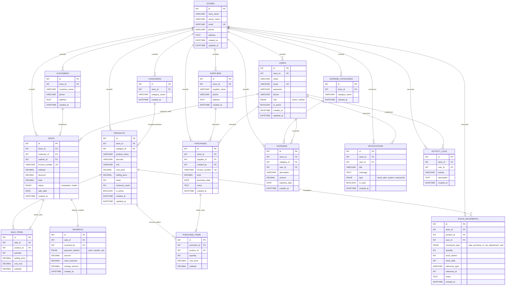

# ENTITY RELATIONSHIP DIAGRAM (ERD) & DATABASE SCHEMA
## DATABASE: `umkmate_db` (16 TABEL)

Dokumen ini mendefinisikan rancangan basis data relasional untuk sistem **UMKMate**.

---

## 1. Diagram ERD (Mermaid)

---

## 2. Rincian Kamus Data & Spesifikasi 16 Tabel

### Tabel 1: `stores`
Menyimpan identitas toko fisik.
- `id`: INT AUTO_INCREMENT, PRIMARY KEY
- `store_name`: VARCHAR(150), NOT NULL
- `owner_name`: VARCHAR(100), NOT NULL
- `email`: VARCHAR(150), UNIQUE, NOT NULL
- `phone`: VARCHAR(25), NOT NULL
- `address`: TEXT, NULL
- `created_at`: DATETIME DEFAULT CURRENT_TIMESTAMP
- `updated_at`: DATETIME DEFAULT CURRENT_TIMESTAMP ON UPDATE CURRENT_TIMESTAMP

### Tabel 2: `users`
Menyimpan kredensial owner dan kasir.
- `id`: INT AUTO_INCREMENT, PRIMARY KEY
- `store_id`: INT, NOT NULL, FK -> `stores(id)` ON DELETE CASCADE
- `name`: VARCHAR(100), NOT NULL
- `email`: VARCHAR(150), UNIQUE, NOT NULL
- `password`: VARCHAR(255), NOT NULL (bcrypt hash)
- `phone`: VARCHAR(25), NULL
- `role`: ENUM('owner', 'cashier'), NOT NULL DEFAULT 'cashier'
- `is_active`: TINYINT(1) DEFAULT 1
- `created_at`: DATETIME DEFAULT CURRENT_TIMESTAMP
- `updated_at`: DATETIME DEFAULT CURRENT_TIMESTAMP ON UPDATE CURRENT_TIMESTAMP
- *Indexes*: `(store_id, role)`, `(email)`

### Tabel 3: `categories`
Kategori klasifikasi barang warung (Sembako, Minuman, Rokok, Makanan Ringan, Sabun & Mandi).
- `id`: INT AUTO_INCREMENT, PRIMARY KEY
- `store_id`: INT, NOT NULL, FK -> `stores(id)` ON DELETE CASCADE
- `category_name`: VARCHAR(100), NOT NULL
- `created_at`: DATETIME DEFAULT CURRENT_TIMESTAMP
- *Indexes*: `(store_id, category_name)`

### Tabel 4: `products`
Katalog master produk.
- `id`: INT AUTO_INCREMENT, PRIMARY KEY
- `store_id`: INT, NOT NULL, FK -> `stores(id)` ON DELETE CASCADE
- `category_id`: INT, NULL, FK -> `categories(id)` ON DELETE SET NULL
- `product_name`: VARCHAR(200), NOT NULL
- `barcode`: VARCHAR(100), NULL
- `unit`: VARCHAR(30), DEFAULT 'Pcs'
- `cost_price`: DECIMAL(15, 2) NOT NULL DEFAULT 0.00
- `selling_price`: DECIMAL(15, 2) NOT NULL DEFAULT 0.00
- `stock`: INT NOT NULL DEFAULT 0
- `minimum_stock`: INT NOT NULL DEFAULT 5
- `is_active`: TINYINT(1) DEFAULT 1
- `created_at`: DATETIME DEFAULT CURRENT_TIMESTAMP
- `updated_at`: DATETIME DEFAULT CURRENT_TIMESTAMP ON UPDATE CURRENT_TIMESTAMP
- *Indexes*: `(store_id, barcode)`, `(store_id, is_active)`, `(store_id, stock)`

### Tabel 5: `suppliers`
Data rekanan pemasok atau agen grosir.
- `id`: INT AUTO_INCREMENT, PRIMARY KEY
- `store_id`: INT, NOT NULL, FK -> `stores(id)` ON DELETE CASCADE
- `supplier_name`: VARCHAR(150), NOT NULL
- `phone`: VARCHAR(25), NULL
- `address`: TEXT, NULL
- `created_at`: DATETIME DEFAULT CURRENT_TIMESTAMP
- *Indexes*: `(store_id, supplier_name)`

### Tabel 6: `purchases`
Transaksi pembelian stok barang masuk dari supplier.
- `id`: INT AUTO_INCREMENT, PRIMARY KEY
- `store_id`: INT, NOT NULL, FK -> `stores(id)` ON DELETE RESTRICT
- `supplier_id`: INT, NULL, FK -> `suppliers(id)` ON DELETE SET NULL
- `created_by`: INT, NOT NULL, FK -> `users(id)` ON DELETE RESTRICT
- `invoice_number`: VARCHAR(50), NOT NULL, UNIQUE
- `total`: DECIMAL(15, 2) NOT NULL DEFAULT 0.00
- `purchase_date`: DATE NOT NULL
- `notes`: TEXT, NULL
- `created_at`: DATETIME DEFAULT CURRENT_TIMESTAMP
- *Indexes*: `(store_id, purchase_date)`, `(invoice_number)`

### Tabel 7: `purchase_items`
Rincian item barang pada faktur pembelian.
- `id`: INT AUTO_INCREMENT, PRIMARY KEY
- `purchase_id`: INT, NOT NULL, FK -> `purchases(id)` ON DELETE CASCADE
- `product_id`: INT, NOT NULL, FK -> `products(id)` ON DELETE RESTRICT
- `quantity`: INT NOT NULL
- `cost_price`: DECIMAL(15, 2) NOT NULL
- `subtotal`: DECIMAL(15, 2) NOT NULL
- *Indexes*: `(purchase_id)`, `(product_id)`

### Tabel 8: `customers`
Buku data pelanggan warung.
- `id`: INT AUTO_INCREMENT, PRIMARY KEY
- `store_id`: INT, NOT NULL, FK -> `stores(id)` ON DELETE CASCADE
- `customer_name`: VARCHAR(150), NOT NULL
- `phone`: VARCHAR(25), NULL
- `address`: TEXT, NULL
- `created_at`: DATETIME DEFAULT CURRENT_TIMESTAMP
- *Indexes*: `(store_id, customer_name)`, `(store_id, phone)`

### Tabel 9: `sales`
Faktur transaksi penjualan kasir (POS).
- `id`: INT AUTO_INCREMENT, PRIMARY KEY
- `store_id`: INT, NOT NULL, FK -> `stores(id)` ON DELETE RESTRICT
- `customer_id`: INT, NULL, FK -> `customers(id)` ON DELETE SET NULL
- `cashier_id`: INT, NOT NULL, FK -> `users(id)` ON DELETE RESTRICT
- `invoice_number`: VARCHAR(50), NOT NULL, UNIQUE
- `subtotal`: DECIMAL(15, 2) NOT NULL DEFAULT 0.00
- `discount`: DECIMAL(15, 2) NOT NULL DEFAULT 0.00
- `total`: DECIMAL(15, 2) NOT NULL DEFAULT 0.00
- `status`: ENUM('completed', 'voided') NOT NULL DEFAULT 'completed'
- `sale_date`: DATE NOT NULL
- `created_at`: DATETIME DEFAULT CURRENT_TIMESTAMP
- *Indexes*: `(store_id, sale_date)`, `(store_id, status)`, `(cashier_id)`, `(invoice_number)`

### Tabel 10: `sale_items`
Rincian produk yang terjual pada satu nota belanja.
- `id`: INT AUTO_INCREMENT, PRIMARY KEY
- `sale_id`: INT, NOT NULL, FK -> `sales(id)` ON DELETE CASCADE
- `product_id`: INT, NOT NULL, FK -> `products(id)` ON DELETE RESTRICT
- `quantity`: INT NOT NULL
- `selling_price`: DECIMAL(15, 2) NOT NULL
- `unit_cost`: DECIMAL(15, 2) NOT NULL *(Snapshot HPP saat penjualan)*
- `subtotal`: DECIMAL(15, 2) NOT NULL
- *Indexes*: `(sale_id)`, `(product_id)`

### Tabel 11: `payments`
Pencatatan pelunasan faktur penjualan.
- `id`: INT AUTO_INCREMENT, PRIMARY KEY
- `sale_id`: INT, NOT NULL, UNIQUE, FK -> `sales(id)` ON DELETE CASCADE
- `received_by`: INT, NOT NULL, FK -> `users(id)` ON DELETE RESTRICT
- `payment_method`: ENUM('cash', 'transfer', 'qris') NOT NULL DEFAULT 'cash'
- `amount`: DECIMAL(15, 2) NOT NULL
- `cash_received`: DECIMAL(15, 2) NOT NULL DEFAULT 0.00
- `change_amount`: DECIMAL(15, 2) NOT NULL DEFAULT 0.00
- `created_at`: DATETIME DEFAULT CURRENT_TIMESTAMP
- *Indexes*: `(sale_id)`, `(payment_method)`

### Tabel 12: `stock_movements`
Audit log mutasi fisik stok barang (inflow/outflow).
- `id`: INT AUTO_INCREMENT, PRIMARY KEY
- `store_id`: INT, NOT NULL, FK -> `stores(id)` ON DELETE CASCADE
- `product_id`: INT, NOT NULL, FK -> `products(id)` ON DELETE RESTRICT
- `user_id`: INT, NOT NULL, FK -> `users(id)` ON DELETE RESTRICT
- `movement_type`: ENUM('sale', 'purchase', 'in', 'out', 'adjustment', 'void') NOT NULL
- `quantity`: INT NOT NULL
- `stock_before`: INT NOT NULL
- `stock_after`: INT NOT NULL
- `reference_type`: VARCHAR(50), NULL *(e.g., 'sale', 'purchase', 'manual')*
- `reference_id`: INT, NULL
- `notes`: TEXT, NULL
- `created_at`: DATETIME DEFAULT CURRENT_TIMESTAMP
- *Indexes*: `(store_id, product_id)`, `(store_id, created_at)`

### Tabel 13: `expenses`
Buku kas pengeluaran operasional warung.
- `id`: INT AUTO_INCREMENT, PRIMARY KEY
- `store_id`: INT, NOT NULL, FK -> `stores(id)` ON DELETE CASCADE
- `category_id`: INT, NULL, FK -> `expense_categories(id)` ON DELETE SET NULL
- `user_id`: INT, NOT NULL, FK -> `users(id)` ON DELETE RESTRICT
- `description`: VARCHAR(255), NOT NULL
- `amount`: DECIMAL(15, 2) NOT NULL DEFAULT 0.00
- `expense_date`: DATE NOT NULL
- `created_at`: DATETIME DEFAULT CURRENT_TIMESTAMP
- *Indexes*: `(store_id, expense_date)`, `(category_id)`

### Tabel 14: `expense_categories`
Kategori pengeluaran (Listrik & Air, Sewa Tempat, Operasional, Transportasi/Bensin, Kebersihan).
- `id`: INT AUTO_INCREMENT, PRIMARY KEY
- `store_id`: INT, NOT NULL, FK -> `stores(id)` ON DELETE CASCADE
- `category_name`: VARCHAR(100), NOT NULL
- `created_at`: DATETIME DEFAULT CURRENT_TIMESTAMP
- *Indexes*: `(store_id, category_name)`

### Tabel 15: `notifications`
Pemberitahuan sistem internal (stok menipis, peringatan toko).
- `id`: INT AUTO_INCREMENT, PRIMARY KEY
- `store_id`: INT, NOT NULL, FK -> `stores(id)` ON DELETE CASCADE
- `user_id`: INT, NULL, FK -> `users(id)` ON DELETE CASCADE
- `title`: VARCHAR(150), NOT NULL
- `message`: TEXT, NOT NULL
- `type`: ENUM('stock_alert', 'system', 'transaction') NOT NULL DEFAULT 'system'
- `is_read`: TINYINT(1) DEFAULT 0
- `created_at`: DATETIME DEFAULT CURRENT_TIMESTAMP
- *Indexes*: `(store_id, is_read)`, `(user_id)`

### Tabel 16: `activity_logs`
Audit jejak rekam aktivitas pengguna (login, ubah harga, void nota).
- `id`: INT AUTO_INCREMENT, PRIMARY KEY
- `store_id`: INT, NOT NULL, FK -> `stores(id)` ON DELETE CASCADE
- `user_id`: INT, NOT NULL, FK -> `users(id)` ON DELETE RESTRICT
- `activity`: VARCHAR(100), NOT NULL
- `description`: TEXT, NULL
- `created_at`: DATETIME DEFAULT CURRENT_TIMESTAMP
- *Indexes*: `(store_id, created_at)`, `(user_id)`
