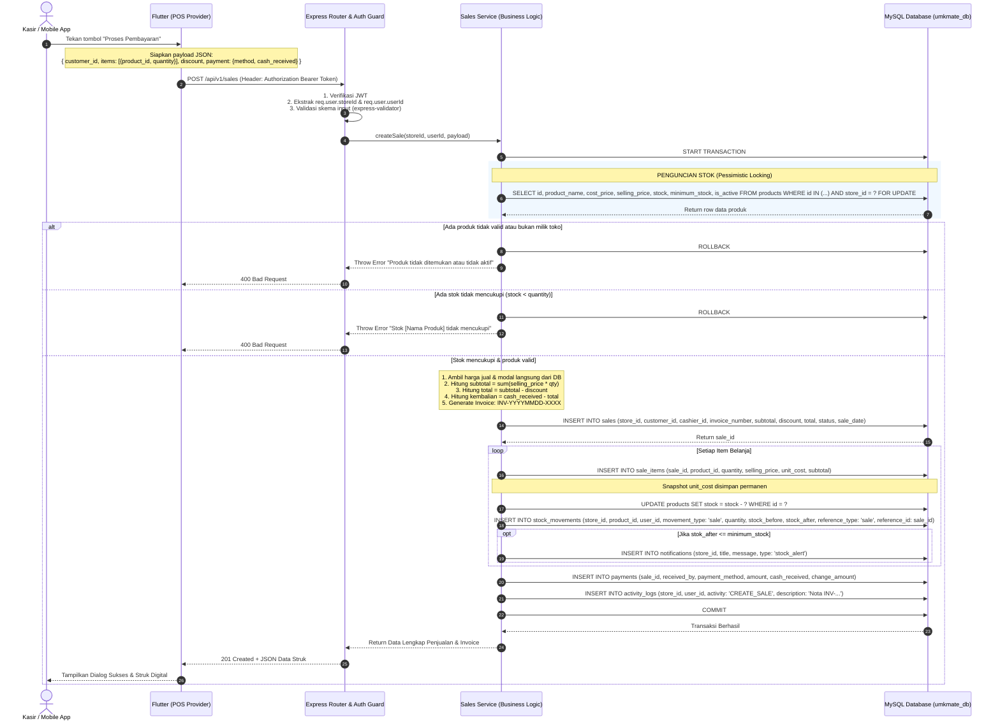

# ALUR PROSES TRANSAKSI PENJUALAN (SALES TRANSACTION FLOW)
## KONSISTENSI ACID & ATURAN BISNIS KASIR

Dokumen ini menjelaskan secara rinci alur proses checkout kasir pada aplikasi **UMKMate**, mulai dari input di antarmuka ponsel hingga eksekusi query transaksi database MySQL yang mematuhi prinsip ACID.

---

## 1. Sequence Diagram Alur Checkout

---

## 2. Rincian Langkah & Pencegahan Masalah Bisnis

### A. Pencegahan Kecurangan Harga (Price Tampering)
- **Aturan:** Flutter **TIDAK** dipercaya untuk menentukan harga jual (`selling_price`) maupun harga modal (`cost_price`).
- **Implementasi:** Backend selalu membaca harga terbaru dari tabel `products` saat transaksi diproses. Jika di sisi client harga diubah secara ilegal, perhitungan backend tetap menggunakan harga resmi database.

### B. Pencegahan Race Condition & Stok Negatif
- **Masalah:** Jika dua kasir melakukan checkout produk terakhir yang tersisa 1 buah secara bersamaan, tanpa penguncian stok kedua kasir bisa sama-sama berhasil sehingga stok menjadi `-1`.
- **Solusi:** Eksekusi `SELECT ... FOR UPDATE` di dalam `START TRANSACTION`. Transaksi kedua akan menunggu (lock) hingga transaksi pertama selesai dan melakukan commit/rollback. Ketika giliran transaksi kedua memeriksa stok, stok telah bernilai 0 dan backend langsung melempar pesan error bahwa stok habis.

### C. Snapshot HPP (Historical Cost Price Accuracy)
- **Aturan:** Harga modal produk bisa naik turun dari waktu ke waktu karena pembelian grosir baru.
- **Implementasi:** Kolom `sale_items.unit_cost` menyimpan snapshot harga modal pada detik transaksi terjadi. Dengan demikian, jika 2 bulan kemudian harga modal beras naik dari Rp 12.000 menjadi Rp 14.000, laporan laba kotor transaksi lama tidak akan berubah.

### D. Mekanisme Void / Pembatalan Transaksi
1. Hanya dapat dilakukan oleh pengguna ber-role `owner`.
2. Status penjualan diubah menjadi `status = 'voided'` (data tidak dihapus fisik).
3. Seluruh kuantitas barang yang ada di `sale_items` dikembalikan ke stok `products`:
   `UPDATE products SET stock = stock + quantity WHERE id = product_id`.
4. Pergerakan stok dicatat dengan `movement_type = 'void'`.
5. Tercatat di `activity_logs` dengan alasan pembatalan.
