# USE CASE OWNER DAN KASIR & MATRIKS HAK AKSES
## APLIKASI UMKMATE

---

## 1. Diagram Use Case (Mermaid)

```mermaid
flowchart LR
    subgraph Pengguna
        Owner["Owner (Pemilik Toko)"]
        Kasir["Kasir (Staff)"]
    end

    subgraph Modul_Autentikasi["1. Autentikasi & Akun"]
        UC1["Registrasi Toko & Owner"]
        UC2["Login Akun"]
        UC3["Lupa & Reset Password"]
        UC4["Kelola Profil Toko & Pengguna"]
        UC5["Kelola Akun Kasir (CRUD)"]
    end

    subgraph Modul_POS["2. Penjualan & Kasir (POS)"]
        UC6["Katalog & Cari Produk"]
        UC7["Scan Barcode Barang"]
        UC8["Kelola Keranjang Belanja"]
        UC9["Proses Checkout & Bayar"]
        UC10["Cetak / Bagikan Struk Digital"]
        UC11["Lihat Riwayat Penjualan Pribadi"]
        UC12["Lihat Semua Riwayat Penjualan Toko"]
        UC13["Batalkan (Void) Transaksi"]
    end

    subgraph Modul_Inventaris["3. Produk & Inventaris"]
        UC14["Kelola Produk (Tambah/Edit/Nonaktif)"]
        UC15["Kelola Kategori"]
        UC16["Pencatatan Stok Masuk"]
        UC17["Pencatatan Stok Keluar"]
        UC18["Monitoring Mutasi Stok"]
        UC19["Notifikasi Stok Menipis"]
    end

    subgraph Modul_Relasi["4. Pemasok & Pembelian"]
        UC20["Kelola Data Pelanggan"]
        UC21["Kelola Data Pemasok"]
        UC22["Catat Pembelian Barang (Restock)"]
        UC23["Lihat Riwayat Pembelian Grosir"]
    end

    subgraph Modul_Keuangan["5. Laporan & Keuangan"]
        UC24["Dashboard Analitik & Grafik Penjualan"]
        UC25["Kelola Biaya Operasional / Pengeluaran"]
        UC26["Laporan Laba Kotor (Gross Profit)"]
        UC27["Laporan Keuangan Komprehensif"]
        UC28["Audit Log Aktivitas Toko"]
    end

    %% Hubungan Kasir
    Kasir --> UC2
    Kasir --> UC3
    Kasir --> UC4
    Kasir --> UC6
    Kasir --> UC7
    Kasir --> UC8
    Kasir --> UC9
    Kasir --> UC10
    Kasir --> UC11
    Kasir --> UC20
    Kasir --> UC19

    %% Hubungan Owner
    Owner --> UC1
    Owner --> UC2
    Owner --> UC3
    Owner --> UC4
    Owner --> UC5
    Owner --> UC6
    Owner --> UC7
    Owner --> UC8
    Owner --> UC9
    Owner --> UC10
    Owner --> UC12
    Owner --> UC13
    Owner --> UC14
    Owner --> UC15
    Owner --> UC16
    Owner --> UC17
    Owner --> UC18
    Owner --> UC19
    Owner --> UC20
    Owner --> UC21
    Owner --> UC22
    Owner --> UC23
    Owner --> UC24
    Owner --> UC25
    Owner --> UC26
    Owner --> UC27
    Owner --> UC28
```

---

## 2. Matriks Hak Akses (Role-Based Access Control)

| Fitur / Modul | Owner | Kasir | Keterangan & Proteksi Backend |
|---|:---:|:---:|---|
| **Registrasi Toko** | ✅ | ❌ | Terbuka untuk umum saat onboarding toko baru. |
| **Login Aplikasi** | ✅ | ✅ | Backend memvalidasi status `is_active = 1`. |
| **Kelola Profil Pribadi** | ✅ | ✅ | Nama, no telepon, ganti password. |
| **Kelola Profil Toko** | ✅ | ❌ | Hanya role `owner` (`requireRole('owner')`). |
| **Kelola Kasir (Tambah/Nonaktif)** | ✅ | ❌ | Hanya role `owner`. Kasir tidak dapat melihat menu ini. |
| **Katalog & Scan Barcode** | ✅ | ✅ | Kasir tidak dapat melihat `cost_price` (harga modal). |
| **Tambah/Edit/Hapus Produk** | ✅ | ❌ | Kasir diblokir backend jika memanggil endpoint produk `POST/PUT/DELETE`. |
| **Kelola Kategori Produk** | ✅ | ❌ | Master data hanya dikelola oleh Owner. |
| **Transaksi Kasir (POS)** | ✅ | ✅ | Keranjang, kalkulasi, pilih metode bayar, simpan transaksi. |
| **Cetak & Bagikan Struk** | ✅ | ✅ | Nomor nota otomatis, rincian barang, total bayar. |
| **Riwayat Penjualan** | Semua | Hanya Milik Sendiri | Query disaring otomatis di backend: kasir difilter `cashier_id = req.user.userId`. |
| **Void / Batalkan Transaksi** | ✅ | ❌ | Kasir tidak boleh menghapus atau membatalkan transaksi. |
| **Pencatatan Stok Masuk/Keluar** | ✅ | ❌ | Penyesuaian opname atau barang rusak hanya via otorisasi Owner. |
| **Kelola Pemasok & Pembelian** | ✅ | ❌ | Faktur pembelian grosir bersifat rahasia toko. |
| **Kelola Pelanggan** | ✅ | ✅ | Kasir dapat mendaftarkan pelanggan baru saat belanja. |
| **Pencatatan Pengeluaran Warung** | ✅ | ❌ | Buku pengeluaran operasional toko. |
| **Dashboard Grafik & Omset** | ✅ | ❌ | Kasir hanya memiliki dashboard ringkas transaksi shift miliknya. |
| **Laporan Laba Kotor & Keuangan** | ✅ | ❌ | Hak eksklusif Owner untuk melihat profitabilitas dan HPP. |
| **Audit Log Aktivitas** | ✅ | ❌ | Jejak audit keamanan sistem hanya diakses Owner. |
